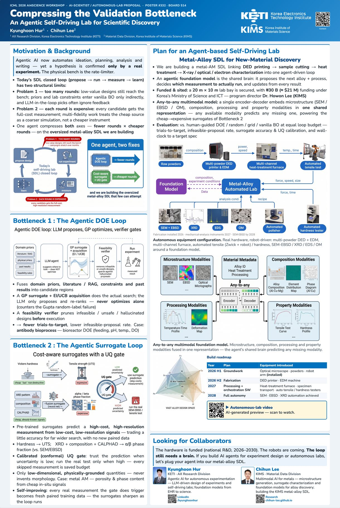

# academic-poster-skill

A [Claude Code](https://claude.com/claude-code) skill that takes a paper and produces a
**print-ready, browser-editable conference poster** — an evolution of
[ethanweber/posterskill](https://github.com/ethanweber/posterskill) hardened on a real
ICML 2026 workshop poster (91 × 61 cm portrait, built end-to-end with this pipeline).

**v2 — big type, few words (default).** Body text is 26 pt on an A1-class board, the whole
poster carries ≤ 250 words, and the QA script fails the build when text gets too small, too
long or too many — so content is *cut*, never shrunk to fit. The dense v1 template
(18–20 pt body, ~450 words) is kept at tag [`v1`](https://github.com/Chihun-Lee/academic-poster-skill/tree/v1).

<p align="center"><br>
<sub>The ICML poster above was built with v1 (dense). v2 targets roughly half the words at ~1.3× the type size.</sub></p>

## What you get

- **Big-type defaults**: 4 type levels (title 72 / header 40 / body 26 / caption 22 pt at
  scale 1.0), big-number `.stats` callouts, ≤ 3 short bullets per card. Scale with the
  board: body pt ≈ short side mm / 23.

- **Editable HTML poster** (React, no build step): drag dividers to resize cards, swap cards,
  scale fonts, then `Copy Config` to persist the layout.
- **Gemini-drawn figures** in one consistent style — with automatic handling of the two things
  that bite everyone: the *fake checkerboard transparency* (generate on solid white + trim)
  and the *visible watermark* (reserve a bottom white band in the prompt, crop it off after).
  Works with an API key **or** prints paste-ready prompts if you'd rather generate manually.
- **Automated QA loop**: a Playwright script measures per-card overflow (clipped content /
  dead whitespace), orphan lines, the total word count (`--max-words 250`), text printed
  below `--min-pt 20`, and bullets wrapping past 2 lines — then prints `VERDICT: CLEAN` or
  what to fix.
- **Exact-size PDF** via headless Chromium (`610 mm × 910 mm` or whatever your board wants).
- **Single-file share export**: React, fonts and images inlined → one HTML file (~2 MB
  compressed or lossless HQ) that opens offline in any browser, so co-authors can adjust the
  layout and send the config back.

## Install (as a Claude Code skill)

```bash
git clone https://github.com/Chihun-Lee/academic-poster-skill \
  ~/.claude/skills/academic-poster
```

Then in Claude Code: *"make a poster for my paper — portrait 91×61 cm, board 514"* — the
skill drives the whole flow (`SKILL.md` is the playbook; scripts do the heavy lifting).

## Use the scripts directly (no Claude required)

```bash
pip install playwright pillow numpy && playwright install chromium   # or just have Google Chrome installed

# 1. copy template.html → index.html, edit the CUSTOMIZE blocks (colors, size, cards)

# 2. figures — with an API key, or omit the key to get a paste-ready prompt
export GEMINI_API_KEY=...   # optional
python scripts/gen_img.py --prompt "closed-loop lab diagram ..." --aspect 16:9 --out fig1.png

# 3. QA + render (repeat after every edit until the report is clean)
python scripts/inspect_render.py index.html --width-mm 610 --height-mm 910 \
    --png preview.png --pdf poster.pdf

# 4. share one file with co-authors
python scripts/build_standalone.py index.html poster_standalone.html
```

## Repository layout

| Path | Purpose |
|---|---|
| `SKILL.md` | The full playbook: phases, typography rules, figure prompts, QA loop, pitfalls table |
| `template.html` | posterskill template + fixes: versioned/validated localStorage, editor-UI-free rendering, justify + `text-wrap:pretty` |
| `scripts/gen_img.py` | Gemini figure generation (API or manual-prompt mode) + watermark band crop + white trim |
| `scripts/inspect_render.py` | Playwright QA: overflow, orphans, word budget, min pt, bullet length; preview PNG, exact-mm PDF |
| `scripts/build_standalone.py` | esbuild-precompiled single-file HTML export (compressed / lossless) |
| `reference/poster_typography.md` | Font sizes & word counts measured from real conference posters |

## Notable fixes over the original posterskill

- **Big type by default** — the original's body text (~12 pt at A1 landscape) is unreadable
  from 2 m; v2 starts at 26 pt and enforces it in QA.
- **localStorage poisoning guard** — the original saves layout under one global key; opening
  any older poster from the same browser could silently delete cards and break logo paths in
  a new one. The template now versions the key per poster (`POSTER_ID`) *and* validates saved
  card ids / re-sources logo paths on load.
- **Clean captures** — `preview` mode now also hides the toolbar, so PDFs and screenshots
  carry zero editor chrome.
- **Typography guards** — body text justified with `text-wrap: pretty` to kill single-word
  orphan lines, backed by the automated detector for the cases CSS can't fix.

## Credits

- Template concept and editor: [ethanweber/posterskill](https://github.com/ethanweber/posterskill)
- Pipeline, QA tooling and fixes: Chihun Lee (KIMS), built with Claude Code.

MIT License.
